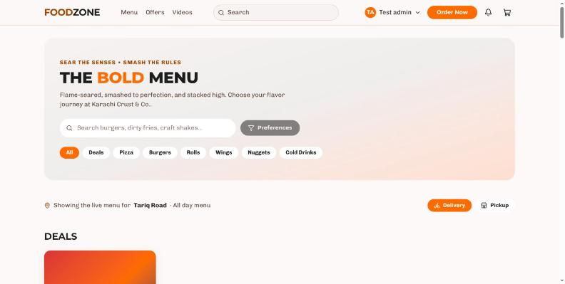

# Opening a new restaurant on FoodZone

Written for: the person setting up a single-branch fast-food restaurant for the
first time — an owner, or whoever is handed the admin login on day one.

This is the real order of operations, worked out by doing it. Every step below
was performed against a clean database; the counts at the end are what came out.
Where a step has a trap in it, the trap is written down rather than smoothed
over, because you will hit it.

The worked example is **Karachi Crust & Co.**, one branch on Tariq Road, selling
pizza, burgers, wings, nuggets, rolls and cold drinks, with dine-in across two
floors, takeaway and delivery.

---

## Before you start

You need one administrator account. Everything below is done from it.

**Do these in order.** The dependencies are real: a product cannot be created
without a category, cannot be sold without a menu, and will not appear to a
customer until it is both published *and* on a switched-on menu. Three of the
four "why can't I see it on the website" questions come from doing these out of
order.

---

## 1. Settings — who the company is

`Dashboard → Administration → Settings`

Each panel saves on its own button. Filling three panels and pressing one Save
leaves two unsaved.

| Field | Example | Why it matters |
|---|---|---|
| Store name | Karachi Crust & Co. | Appears on the storefront, emails and receipts |
| Currency | PKR | Every price in the system is read in this |
| Default timezone | Asia/Karachi | Opening hours, reports and shifts are all read in it |
| Delivery / Pickup / Dine-in | all on | Switches the three order types on across the site |
| Default preparation time | 20 min | The promise shown to customers, and the kitchen's clock |
| Delivery fee / free over / packaging fee | 150 / 2500 / 30 | Added at checkout |
| Minimum order | 500 | Refused below this |

> **Currency and timezone are set twice** — once here for the company and again
> on the branch. The branch wins for anything branch-scoped. Set both to the
> same thing unless you have a reason not to.

## 2. The branch — the physical shop

`Dashboard → Administration → Branches → New branch`

Name, code (`TRQ`), address, phone, delivery radius, timezone, currency.

**Opening hours** are set on the branch page itself: a row per weekday, a tick
to open it, two times, and a **past midnight** tick for a kitchen that closes on
tomorrow's clock. "Copy to the rest" fills the remaining days from the one you
just set, which is one action for a shop that keeps the same hours all week.

The example shop trades 11:00–02:00, seven days.

> Saving replaces the whole week — that is what the endpoint does, because
> merging would leave a window alive that somebody thought they had deleted.
> A day left unticked is simply closed.

## 3. Tables — the room

`Dashboard → Service → Tables`

Use **A whole row**, not One table. It lays out a numbered run in a single
action: prefix, from, to, seats each, pad-to, and an area name.

- `G-` 1→10, 4 seats, pad 2, area **Ground floor**
- `F-` 1→10, 4 seats, pad 2, area **First floor**

Twenty tables in two actions. "Pad to 2" is what makes `G-01` sort before
`G-10` — without it the list reads G-1, G-10, G-2.

The **area** is the floor. It is free text, it groups the tables on screen, and
it is the only thing that distinguishes your two floors — so spell it the same
way every time.

## 4. Kitchen stations — where tickets go

`Dashboard → Menu → Stations`

Each product is routed to one station, and a kitchen screen can be filtered to
one station's tickets. The example shop has **Pizza oven, Grill, Fryer, Cold
station**.

Do this before products: the station is chosen on the product form, and going
back to set it on sixteen products afterwards is sixteen edits.

## 5. Categories — how the menu is grouped

`Dashboard → Menu → Categories → New category`

Pizza, Burgers, Wings, Nuggets, Rolls, Cold Drinks. A product cannot be saved
without one, which is why this comes before products.

## 6. Modifier groups — the questions asked at the till

`Dashboard → Menu → Modifiers → New group`

Built once, attached to as many products as need them. The example shop has:

| Group | Type | Choices |
|---|---|---|
| Choose a crust | one choice | Pan, Hand tossed, Stuffed crust (+250) |
| Extra toppings | several, max 4 | Extra cheese, Pepperoni, Jalapeños, Olives, Chicken tikka |
| Sauces | several, max 3, repeatable | **Ketchup sachet (free)**, Garlic mayo, Hot sauce, BBQ dip |
| How spicy | one choice, required | Mild, Medium, Fire |
| Make it a meal | one choice | No thanks, Add fries and a drink (+350) |

> Sachets and dips belong here, not in the catalogue: a ketchup sachet is a
> choice on a burger, not a line a customer buys. What it *costs you* is
> tracked separately — see step 10.

> **If a save reports a dropped connection, check before retrying.** The
> message now says so explicitly — *"your change may still have been saved —
> reload and check before trying again"* — because a pooled database connection
> can drop after the write has committed. Retrying blindly is what creates the
> duplicate.

## 7. The menu — before the products

`Dashboard → Menu → Menus → New menu`

One menu, **All day menu**, branch Tariq Road, used for **Dine-in**.

One menu covers all three order types: an order type looks for its own menu and
falls back to the dine-in one, so a single-branch shop does not need three.
Create separate menus only when delivery prices genuinely differ.

> **Do this before creating products.** The product form grows a "Put it on a
> menu" section only when a menu exists. Create the menu first and every product
> can be placed as it is created; create it later and you are revisiting every
> product.

> **A first menu goes live on creation; a second one does not.** The form tells
> you which before you press the button. The distinction is displacement: a new
> menu is empty, and an empty menu that wins the pick would leave the branch
> with nothing to sell — so where a live menu of that kind already exists, the
> new one waits for you to press **Switch on**.

## 8. Products

`Dashboard → Menu → Products → New product`

For each: name, category, short description, price (**One price** or **Different
sizes**), station, preparation time, and the menu tick.

Sizes are variants: a pizza with Small/Medium/Large is one product with three
prices, and all three go onto the menu together.

> **Everything is created as a draft.** A draft is invisible to customers. Press
> **Publish** on the product, or it will never appear however correct the rest
> is.

The example shop: 3 pizzas, 3 burgers, 2 wings, 1 nuggets, 3 rolls, 3 drinks.

## 9. Menu sections — the headings customers read

`Dashboard → Menu → Menus → All day menu → Sections`

**Menu sections are not product categories.** A product's category is how the
catalogue is organised; a menu's sections are the headings on that menu. Items
added without one land in a single group the storefront labels **"More"** — the
whole menu under one meaningless heading.

The Sections panel says so while it is true: *"This menu has no headings, so
customers see all 25 items in one group called 'More'."* Once some are filed it
switches to naming how many are still loose.

Deals → Pizza → Burgers → Rolls → Wings → Nuggets → Cold Drinks, with each item
filed under its own.

## 10. Combos

`Dashboard → Menu → Combos`

A combo is a product with slots. **Family Feast — PKR 2,850**:

| Slot | Rule | Choices |
|---|---|---|
| Large pizza | pick 1 | Chicken Tikka Pizza (Large), pre-selected |
| Burgers | pick 2 | Zinger ×2 (included) or Crispy Chicken ×2 (+120) |
| Cold drinks | pick 2 | Pepsi, 7Up — the same drink may be taken twice |

> **A slot's minimum and maximum are counted in portions, not in rows.** "Two
> burgers, no choice" is *one* choice worth two portions, in a slot set to
> min 2 / max 2. Put a two-portion choice in a max-1 slot and it is refused.

## 11. Inventory — what the kitchen consumes

`Dashboard → Inventory`

In order: **Units** (pc, kg, ltr, box) → **Stock location** (Main store, marked
default) → **Supplier** (Metro Cash & Carry, 15-day terms) → **Items**.

Fourteen items covering both kinds of thing a fast-food counter burns through:

- **Materials** — mozzarella, chicken fillet, cooking oil, dough balls, buns
- **Accessories and packaging** — ketchup and mayo sachets, burger boxes, pizza
  boxes (9" and 12"), paper bags, fries scoops, napkins, cutlery sets

Each carries a reorder level and reorder quantity, which is what drives the low
stock warning on the dashboard.

## 12. People

`Dashboard → People`

**Departments first** — Kitchen, Front of house, Delivery — then staff.

Each person is created twice, deliberately: a **user** gives them a login and
sends the invitation; an **employee** record carries the HR side — department,
designation, salary, attendance.

| Role | People |
|---|---|
| Branch manager | 1 |
| Cashier | 1 |
| Waiter | 2 |
| Head chef | 1 |
| Kitchen staff | 2 |
| Delivery rider | 3 |

A rider needs a third record: **Driver**, with vehicle type, registration and
per-delivery payout. Without it they cannot be dispatched.

> Staff receive an invitation email with a code and a link to `/invite`, where
> they set their own password. Nobody — including you — ever sees it.

## 13. The attendance terminal

`Dashboard → People → Terminals`

Register the machine with its serial number and the branch it stands in
(`ZKTeco K40`, serial `ZK-TRQ-001`, Asia/Karachi). Punches from it then arrive
against employee records, and an unmatched punch is reconciled from the
Attendance screen.

---

## What this produced

| | |
|---|---|
| Branch | 1, with 7 days of opening hours |
| Tables | 20 — 10 ground floor, 10 first floor |
| Kitchen stations | 4 |
| Categories / products / variants | 6 / 16 / 25 |
| Modifier groups / options | 5 / 17 |
| Combos | 1, with 3 slots |
| Menu / sections / items | 1 / 7 / 25 |
| Units / locations / suppliers / items | 4 / 1 / 1 / 14 |
| Departments / users / employees / riders | 3 / 11 / 10 / 3 |
| Attendance terminals | 1 |

Recordings of the walkthrough:

- `media/01-foundation-settings-branch-tables.gif` — settings, branch, tables
- `media/02-catalogue-menu-and-storefront.gif` — stations through to the live menu

---

## The order, condensed

1. Settings — name, currency, timezone, order types, fees
2. Branch — address, radius, **hours via API**
3. Tables — bulk rows, one per floor
4. Stations — before products
5. Categories — before products
6. Modifier groups — before products
7. **Menu — before products**, then **switch it on**
8. Products — place on the menu as you go, then **publish**
9. Menu sections — or everything lands under "More"
10. Combos
11. Inventory — units → location → supplier → items
12. People — departments → users → employees → drivers
13. Attendance terminal

## Fixed since this was first written

The first pass through this setup turned up four problems. All four have been
dealt with, and the steps above describe the behaviour as it is now:

1. **Opening hours had no editor at all** — the API had one, the dashboard did
   not. There is now a weekday editor on the branch page (step 2).
2. **A new menu was always created switched off**, with no control on the form
   and no warning after. It now goes live unless it would displace a live menu
   of the same kind, and the form says which before you commit (step 7).
3. **A dropped database connection reported a flat "Something went wrong"** even
   though the write had landed. Those failures are now identified and described
   honestly, and a write says the change may have been saved (step 6).
4. **Nothing prompted for menu sections.** The Sections panel now says, while
   it is true, that the whole menu is sitting under one "More" heading
   (step 9).
